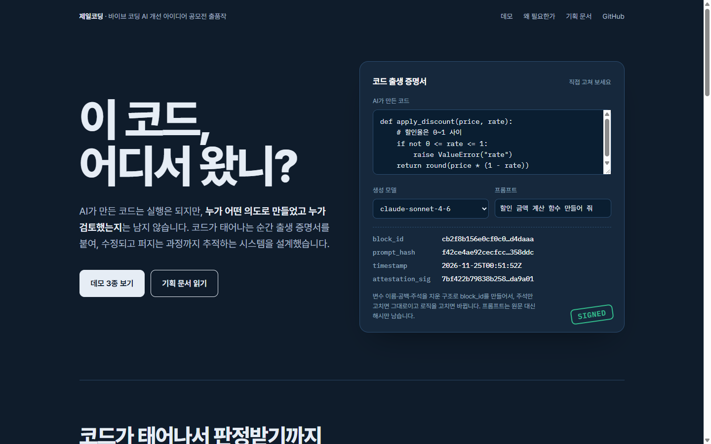
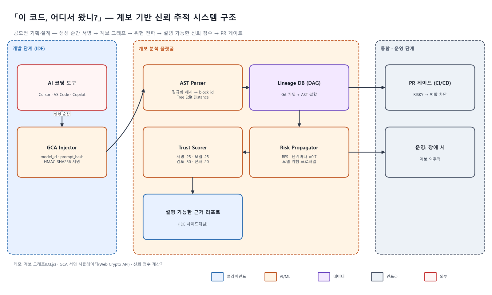
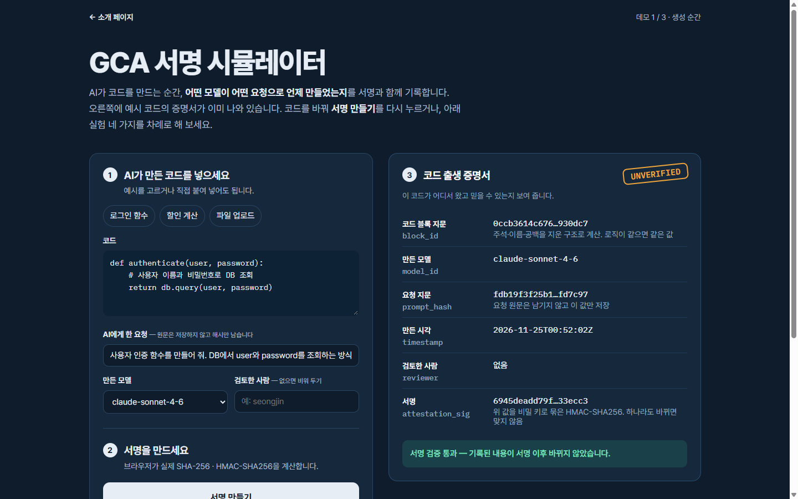
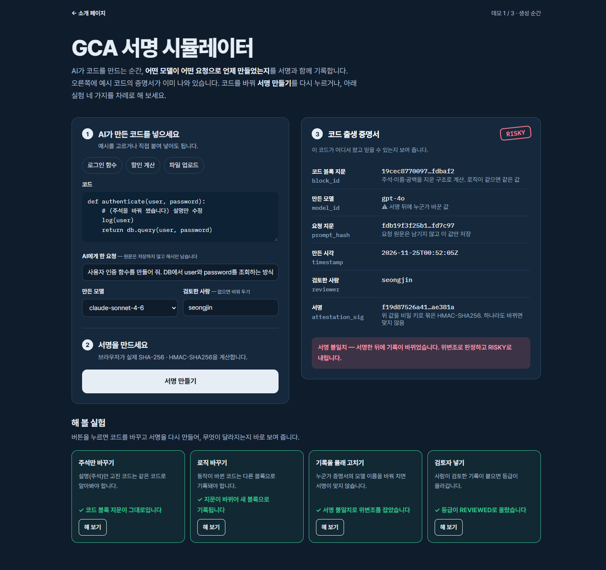
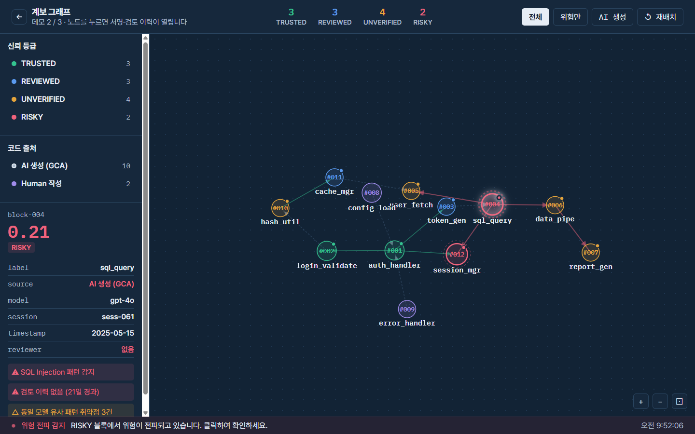
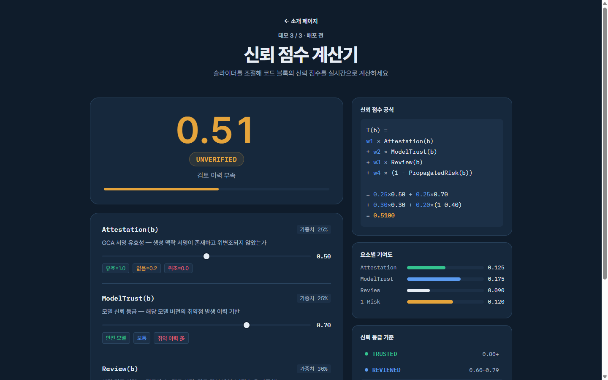

<div align="center">

# 이 코드, 어디서 왔니?

**AI 생성 코드의 계보 기반 신뢰 추적 시스템**<br>
AI가 만든 코드에 출생 증명서를 붙여, 어디서 왔고 믿을 수 있는지 추적합니다.

[](https://vibe-coding-research.github.io/vibe-coding-improvement/)
[](https://vibe-coding-research.github.io/vibe-coding-improvement/Demo_code/Gca_simulator.html)
[](https://vibe-coding-research.github.io/vibe-coding-improvement/Demo_code/Lineage_graph.html)
[](https://vibe-coding-research.github.io/vibe-coding-improvement/Demo_code/Trust_score_calculator.html)

<a href="https://vibe-coding-research.github.io/vibe-coding-improvement/"></a>

바이브 코딩 AI 개선 아이디어 공모전 출품작 · 팀 제일코딩 · 2026

</div>

<br>

## 한눈에 보기

> **"이 코드는 어디서 왔는가? 왜 이렇게 작성되었는가? 그리고 이 코드를 신뢰할 수 있는가?"**

AI가 만든 코드는 실행은 되지만, 누가 어떤 의도로 만들었고 누가 검토했는지는 남지 않습니다. Git은 *무엇이* 바뀌었는지는 남기지만 *어떤 의도였고 AI와 사람 중 누가 판단했는지*는 남기지 않습니다.

이 프로젝트는 코드가 **태어나는 순간 서명을 남기고**, 수정·전파되는 **계보를 추적하고**, 배포 전에 **근거가 보이는 신뢰 점수**로 판정하는 시스템을 설계했습니다. 설계·기획 중심 공모전이지만, 핵심 개념은 브라우저에서 바로 돌아가는 데모 3종으로 만들었습니다.

| 관점 | 아이디어 | 해결하는 문제 | 핵심 기술 |
|---|---|---|---|
| 기술 | **생성 맥락 서명 (GCA)** | AI 코드의 출처를 알 수 없음 | AST 정규화 + HMAC 서명 |
| 프로세스 | **세션 단위 계보 추적** | 프롬프트와 코드의 인과관계가 사라짐 | 세션 그래프 모델링 |
| 운영 | **위험 전파 경로 분석** | 취약점이 조용히 퍼짐 | DAG 기반 위험 전파 |
| 검증 | **설명 가능한 신뢰 점수** | 실행 성공을 품질 보증으로 착각 | 다차원 신뢰 스코어링 |

### 시스템 구조 (제안)



<br>

## 데모 — 코드가 태어나서 판정받기까지

설치 없이 브라우저에서 바로 열립니다. 이미지를 누르면 데모가 실행됩니다.

### 1. 생성 순간 — GCA 서명 시뮬레이터

<a href="https://vibe-coding-research.github.io/vibe-coding-improvement/Demo_code/Gca_simulator.html"></a>

AI가 코드를 만드는 순간, **어떤 모델이 어떤 요청으로 언제 만들었는지**를 서명과 함께 기록합니다. 브라우저의 Web Crypto로 실제 SHA-256과 HMAC-SHA256을 계산합니다.

- **코드 블록 지문(block_id)** — 주석·변수 이름·공백을 지운 구조로 계산해, 설명만 고친 코드는 같은 코드로 알아봅니다
- **요청 지문(prompt_hash)** — 요청 원문은 저장하지 않고 해시만 남겨 내용은 비공개, 검증은 가능
- **서명(attestation_sig)** — 위 값을 비밀 키로 묶어, 하나라도 바뀌면 서명이 맞지 않습니다

<details>
<summary><b>버튼 하나로 해 보는 실험 4가지</b> (펼치기)</summary>
<br>

| 실험 | 확인하는 것 | 결과 |
|---|---|---|
| 주석만 바꾸기 | 설명만 고친 코드를 같은 코드로 알아보는가 | 코드 블록 지문 그대로 |
| 로직 바꾸기 | 동작이 바뀐 코드를 새 블록으로 기록하는가 | 지문이 바뀜 |
| 기록을 몰래 고치기 | 서명 뒤에 모델 이름을 바꿔 치면 잡아내는가 | 서명 불일치 → RISKY |
| 검토자 넣기 | 사람 검토 기록이 등급에 반영되는가 | UNVERIFIED → REVIEWED |



</details>

### 2. 수정·전파 — 계보 그래프

<a href="https://vibe-coding-research.github.io/vibe-coding-improvement/Demo_code/Lineage_graph.html"></a>

코드 블록의 생성부터 전파까지를 방향성 비순환 그래프(DAG)로 그립니다. 노드를 누르면 서명 정보·생성 세션·검토 이력·경고가 열립니다.

| 색 | 등급 | 뜻 |
|---|---|---|
| 🟢 | TRUSTED | 서명 검증 + 검토 이력 완비 |
| 🔵 | REVIEWED | 검토됐으나 일부 미비 |
| 🟠 | UNVERIFIED | 검토 이력 부족 |
| 🔴 | RISKY | 출처 불명 또는 취약점 전파 중 |

선은 세 종류입니다 — **초록 실선** 파생(이 블록을 바탕으로 새 블록이 생김), **회색 점선** 의존, **빨간 실선** 위험 전파. 취약점은 빨간 선을 따라 퍼지고, 한 단계 멀어질 때마다 위험이 0.7배로 줄어듭니다.

### 3. 배포 전 — 신뢰 점수 계산기

<a href="https://vibe-coding-research.github.io/vibe-coding-improvement/Demo_code/Trust_score_calculator.html"></a>

네 요소를 슬라이더로 움직이면 점수와 등급이 바로 바뀝니다. 숫자 하나가 아니라 **어떤 요소 때문에 그 점수인지**를 계산식과 기여도로 함께 보여 줍니다.

```
신뢰 점수 = 0.25 × 서명 유효성 + 0.25 × 모델 신뢰 등급 + 0.30 × 사람 검토 이력 + 0.20 × (1 − 전파 위험도)
TRUSTED ≥ 0.80 · REVIEWED 0.60~0.79 · UNVERIFIED 0.40~0.59 · RISKY < 0.40
```

사람 검토 이력의 가중치(30%)가 가장 큽니다. 검토 이력이 없으면 나머지가 모두 만점이어도 0.70이라 **TRUSTED가 될 수 없습니다** — AI가 만든 코드의 신뢰는 결국 사람의 검토에서 나온다는 설계 의도입니다.

<br>

## 기획 문서

문제 정의부터 한계까지, 순서대로 읽으면 설계의 이유가 이어집니다.

| | 문서 | 내용 |
|---|---|---|
| 1 | [문제 정의](./Documents/1-problem-definition.md) | 바이브 코딩이 만드는 세 가지 단절 — 이해·검증·이력 |
| 2 | [원인 분석](./Documents/2-root-cause-analysis.md) | 생산 속도와 검증 속도의 비대칭, 기존 도구가 Snapshot만 보는 한계 |
| 3 | [핵심 아이디어](./Documents/3-core-improvement-idea.md) | GCA 서명 · 세션 계보 · 위험 전파 · 신뢰 점수의 상세 설계 |
| 4 | [적용 시나리오와 기대 효과](./Documents/4-application-scenario-and-effect.md) | IDE·PR·장애 대응에서 쓰이는 방식 |
| 5 | [한계와 확장](./Documents/5-limitations-and-extension.md) | 레거시 코드 미서명, AST 추적의 한계와 대응 |

📄 발표 자료: [이 코드, 어디서 왔니? (PDF)](./Documents/이%20코드_%20어디서%20왔니.pdf)

<br>

## 저장소 구성

```
├── index.html                 소개 페이지 (GitHub Pages)
├── Demo_code/
│   ├── Gca_simulator.html     1. 생성 순간 — 서명 시뮬레이터
│   ├── Lineage_graph.html     2. 수정·전파 — 계보 그래프 (D3.js)
│   └── Trust_score_calculator.html   3. 배포 전 — 신뢰 점수 계산기
├── Demo_image/                README·소개 페이지용 화면 · 시스템 구조도
└── Documents/                 기획 문서 5편 + 발표 자료 PDF
```

<br>

## 참여자

<table>
  <tr>
    <td align="center"><a href="https://github.com/FAITRUEE"><br><b>LEE SEONGJIN</b></a></td>
    <td align="center"><a href="https://github.com/ryu2293"><br><b>Seungrae Ryu</b></a></td>
  </tr>
</table>

팀 **제일코딩** · 2인 공동 기획 및 설계 · GitHub Organization 기반 문서 중심 협업

<details>
<summary>대회 개요</summary>
<br>

**바이브 코딩 AI 개선 아이디어 공모전**은 바이브 코딩 개발 환경에서 나타나는 품질·안정성·보안·유지보수 문제를 바탕으로, 기술·프로세스·운영·검증 관점의 현실적인 개선 아이디어를 제안하는 **설계·기획 중심** 공모전입니다. 구현이나 코딩을 요구하지 않으며, 구현 이전 단계의 설계적 사고와 문제 인식 능력을 평가합니다.

</details>
